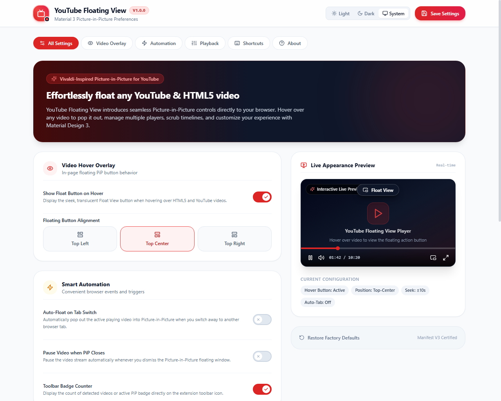

# YouTube Floating View – Picture-in-Picture Chrome Extension

<p align="center">
  
</p>

<p align="center">
  <strong>Vivaldi-inspired Picture-in-Picture extension for YouTube & HTML5 videos with Material Design 3 UI</strong>
</p>

<p align="center">
  
  
  
  
  
</p>

---

## 📸 Options Page Preview (Material Design 3)

Below is the redesigned, modern Material 3 Settings Dashboard (`chrome-extension://<id>/options.html`):

<p align="center">
  
</p>

---

## ✨ Features & Capabilities

- **🎯 Automatic HTML5 & YouTube Video Detection**: Instantly identifies video elements across any website or single-page app (YouTube, Twitch, Vimeo, news websites).
- **🚀 Vivaldi-Inspired Video Hover Overlay**: Hovering over any playing video displays an unobtrusive, glassmorphic **"Float View"** button rendered in an isolated **Shadow DOM** to prevent website CSS conflicts.
- **📱 Real-Time Interactive Live Preview**: The settings dashboard includes an embedded live player preview allowing you to test hover button alignment (**Top Center**, **Top Right**, **Top Left**) and toggle PiP before browsing.
- **🎛️ Multi-Video Selection**: Easily switch between and float specific videos when browsing media-heavy sites with multiple video players.
- **⚡ Keyboard Shortcut**: Press <kbd>Alt</kbd> + <kbd>Shift</kbd> + <kbd>P</kbd> at any time to immediately float the active video.
- **🖱️ Context Menu Integration**: Right-click on any video or web page to select *"Float this video (FloatView PiP)"*.
- **⏯️ Comprehensive Playback Controls**:
  - Play / Pause toggle
  - Timeline progress scrubber
  - Configurable seek steps (±5s, ±10s, ±15s, ±30s)
  - Mute / Unmute and volume slider
- **🎨 Material Design 3 (M3) UI & Themes**:
  - Custom Material 3 toggle switches with sliding animated thumbs and checkmark indicators
  - Segmented button groups for button alignment and seek steps
  - Light, Dark, and System theme synchronization across popup and settings
- **⚙️ Smart Automation**:
  - Auto-PiP when navigating to another tab
  - Pause playback when the PiP window is closed
  - Badge counter display on the extension toolbar icon

---

## 🛠️ Technology Stack

| Technology | Purpose |
| :--- | :--- |
| **Vue 3** (`<script setup>`) | Primary reactive UI framework for popup & options |
| **Material Design 3 (M3)** | Modern design system, rounded surfaces, elevation, and switches |
| **Tailwind CSS** | Utility-first responsive styling and dark mode |
| **Vite & esbuild** | Blazing-fast build tool and standalone IIFE bundler |
| **Chrome Manifest V3** | Modern Chrome Extension architecture |
| **HTML5 Picture-in-Picture API** | Native browser video floating capabilities |
| **Chrome Storage API** | Persistent synchronized user preferences |
| **Lucide Vue Next** | Clean, modern iconography |

---

## 📂 Project Architecture

```text
youtube-floating-view/
├── public/
│   ├── icons/                    # Pixel-perfect 16px, 32px, 48px, 128px PNG icons
│   └── manifest.json             # Manifest V3 specification
├── docs/
│   ├── options-preview.png       # Material 3 options page screenshot
│   └── popup-preview.png         # Extension popup screenshot
├── src/
│   ├── components/
│   │   ├── AppHeader.vue         # Popup header with logo, counter, refresh, settings
│   │   ├── EmptyState.vue        # Zero-state and restricted URL messaging
│   │   ├── LivePreviewPlayer.vue # Interactive real-time video player preview
│   │   ├── MaterialSwitch.vue    # Material 3 switch with sliding thumb & check icon
│   │   ├── PiPButton.vue         # Prominent Float/Exit PiP action button
│   │   ├── QuickControls.vue     # Timeline scrubber, play/pause, seek, volume
│   │   ├── ThemeSelector.vue     # Light / Dark / System segmented toggle
│   │   ├── VideoInfo.vue         # Active video duration, time, resolution
│   │   └── VideoSelector.vue     # Multi-video picker
│   ├── popup/
│   │   ├── App.vue               # Popup Vue 3 application
│   │   └── main.js               # Popup entry point
│   ├── options/
│   │   ├── App.vue               # Material 3 Settings application
│   │   └── main.js               # Settings entry point
│   ├── background/
│   │   └── service-worker.js     # Background worker (shortcuts, contextMenu, badges)
│   ├── content/
│   │   ├── floating-button.js    # Vivaldi-inspired hover overlay (Shadow DOM)
│   │   ├── pip-controller.js     # Native HTML5 PiP execution
│   │   ├── video-detector.js     # DOM video scanning & state serialization
│   │   └── index.js              # Content script runtime coordinator
│   ├── services/
│   │   ├── chromeService.js      # Tabs, runtime, messaging abstraction
│   │   ├── storageService.js     # Chrome Storage (sync + local fallback)
│   │   └── videoService.js       # Video messaging commands
│   ├── composables/
│   │   ├── useTheme.js           # Reactive theme handling and storage sync
│   │   └── useVideoDetection.js  # Video polling, selection, and reactive state
│   ├── constants/
│   │   └── extension.js          # Action types, storage keys, default settings
│   └── styles/
│       └── main.css              # Tailwind CSS directives & scrollbar styling
├── tests/
│   └── extension.test.js         # Automated test suite (25/25 passing)
├── options.html                  # Settings HTML entry
├── popup.html                    # Popup HTML entry
├── vite.config.js                # Vite & esbuild Chrome MV3 bundler
└── package.json                  # Scripts and dependencies
```

---

## 🚀 Installation & Build

### 1. Install Dependencies
```bash
npm install
```

### 2. Development Mode
```bash
npm run dev
```

### 3. Production Build
```bash
npm run build
```
Generates the production-ready extension in the `dist/` directory.

### 4. Run Test Suite
```bash
npm test
```
Verifies all 25 assertions covering Manifest V3 compliance, bundle integrity, and asset links.

---

## 📦 Loading into Google Chrome

1. Open Chrome and navigate to `chrome://extensions/`.
2. Enable **Developer mode** via the toggle in the top-right corner.
3. Click the **Load unpacked** button in the top-left corner.
4. Select the `dist/` directory inside this project:
   ```text
   e:\personal\float-view\dist
   ```
5. Click the extension icon in the toolbar or open `chrome-extension://<id>/options.html` to explore the settings!

---

## ⌨️ Shortcuts & Usage

| Trigger | Action |
| :--- | :--- |
| **Hover on Video** | Reveals translucent "Float View" button at top of video |
| <kbd>Alt</kbd> + <kbd>Shift</kbd> + <kbd>P</kbd> | Toggle Picture-in-Picture for currently playing video |
| **Right-Click** | "Float this video (FloatView PiP)" context menu item |
| **Toolbar Icon** | Open full playback controls, scrubber, and video selector |

---

## 📄 License

MIT License. Designed and built with Vue 3, Material Design 3, and modern Chrome Extension Manifest V3 architecture.
